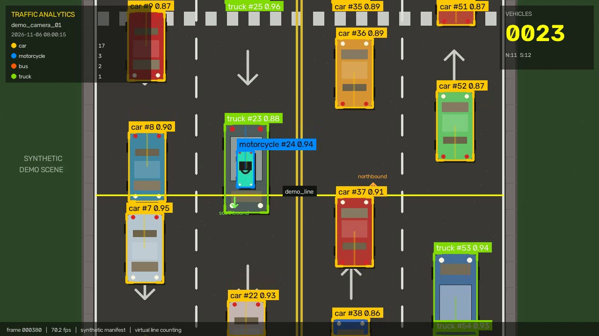
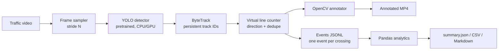

# Intelligent Traffic & Video Analytics

Turn prerecorded traffic footage into structured vehicle data: detect vehicles with a
pretrained YOLO model, keep identities stable with ByteTrack, count direction-aware
line crossings, and export events plus analytics reports.

The project is built for CPU-first experimentation: sample frames, use a small pretrained
model, and get JSONL/CSV output that can be consumed by a data pipeline.



*Synthetic demo run: 750 frames, 47 counted vehicles, live class/direction counters and
a virtual counting line. See `docs/sample_output/` for the full artifacts.*

## Highlights

- **Vehicle detection** with pretrained Ultralytics YOLO (`yolo11n.pt` by default),
  filtered to COCO vehicle classes: car, motorcycle, bus, truck.
- **Persistent tracking** with ByteTrack, exposed as consistent tracking IDs.
- **Direction-aware counting** on one or more virtual lines, with one count per track
  per line by default to avoid double counting.
- **Structured events** in JSONL, validated by a documented schema and a JSON Schema file.
- **Analytics reports**: class/direction breakdown, time-bucket traffic summary, peak
  interval, and a shareable Markdown report.
- **Annotated video** with boxes, IDs, confidence, trails, line arrows, and live totals.
- **Offline demo** that generates a synthetic traffic scene and runs the complete
  pipeline without YOLO, PyTorch, or a video download.
- **Line preview tool** to calibrate counting lines against a real frame in seconds.

## Demo results

The committed sample was produced by the offline synthetic demo (no YOLO inference):

| Metric | Value |
| --- | --- |
| Frames processed | 750 (30 s @ 25 fps, stride 1) |
| Counted events | 47 |
| By class | car 30, motorcycle 9, truck 6, bus 2 |
| By direction | southbound 24, northbound 23 |
| Peak 10-second interval | 08:00:10 - 08:00:20, 18 vehicles |
| Processing speed | ~55 fps (host-dependent; annotation included; synthetic backend) |

Artifacts:

- [Annotated video](docs/sample_output/demo_annotated.mp4)
- [Events JSONL](docs/sample_output/demo_events.jsonl)
- [Markdown report](docs/sample_output/reports/summary.md)
- [Summary JSON](docs/sample_output/reports/summary.json)
- [Preview frame](docs/sample_output/preview.jpg)

The synthetic backend is for pipeline testing only. Real footage uses YOLO + ByteTrack;
the analytics contract is identical.

## Architecture



See [docs/ARCHITECTURE.md](docs/ARCHITECTURE.md) for the counting algorithm, coordinate
spaces, and extension points.

## Quickstart

Requirements: Python 3.10+ and pip.

### Option A - offline demo (no PyTorch, ~1 minute)

```powershell
python -m venv .venv
.\.venv\Scripts\Activate.ps1          # macOS/Linux: source .venv/bin/activate
pip install -r requirements-demo.txt
pip install -e . --no-deps
traffic-analytics demo
```

Outputs are written to `output/demo/`:

```text
output/demo/
  input/demo_input.mp4              # generated road scene
  input/demo_input.manifest.jsonl   # ground-truth boxes for the synthetic backend
  demo_annotated.mp4                # annotated result
  demo_events.jsonl                 # one JSON object per counted vehicle
  preview.jpg
  reports/
    summary.json  summary.md  events.csv  timeseries.csv  breakdown.csv  run_config.json
```

### Option B - real footage with YOLO + ByteTrack

CPU-only PyTorch first (Windows/Linux):

```powershell
pip install torch torchvision --index-url https://download.pytorch.org/whl/cpu
pip install -e .
traffic-analytics doctor
```

On macOS, `pip install -e .` pulls a compatible PyTorch build directly.

1. Put a traffic clip at `data/raw/traffic.mp4` (or pass `--video`).
2. Calibrate the counting line against a frame:

   ```powershell
   traffic-analytics preview-lines --video data/raw/traffic.mp4 --frame 0
   # inspect output/line_preview.jpg, then edit config/config.yaml
   ```

3. Run the analysis:

   ```powershell
   traffic-analytics analyze --video data/raw/traffic.mp4
   ```

The first YOLO run downloads `yolo11n.pt` automatically. Use `--model yolov8n.pt` if you
prefer a different pretrained checkpoint, or pass a local weights path.

For a quick CPU test, cap the run:

```powershell
traffic-analytics analyze --max-frames 300 --frame-stride 3 --no-video
```

### Option C - Google Colab (GPU)

No notebook conversion is required: the package stays the same and Colab simply runs the
CLI. A ready-to-run wrapper is included at
[`notebooks/colab_quickstart.ipynb`](notebooks/colab_quickstart.ipynb).

1. Zip this folder and upload it to Google Drive, or clone your repository in Colab.
2. Open the notebook and select **Runtime > Change runtime type > T4 GPU**.
3. Mount Drive, install the project, and point `VIDEO_PATH` to your clip.
4. Calibrate the line, run `traffic-analytics analyze --device 0`, then copy outputs to Drive.

Colab already provides CUDA-enabled PyTorch, so do not install the CPU wheel there. The
notebook installs Ultralytics and the project with `pip install -e . --no-deps`. It also
re-encodes the annotated `mp4v` video to H.264 for inline playback.

## Configuration

All runtime settings live in [`config/config.yaml`](config/config.yaml). Lines are
defined in **normalized coordinates** (`0.0 - 1.0`), so the same config works at any
resolution:

```yaml
lines:
  - name: main_line
    start: [0.15, 0.55]
    end: [0.85, 0.55]
    positive_direction: southbound
    negative_direction: northbound
```

```text
(0.15, 0.55) ----------------------------- (0.85, 0.55)
        positive side (below the line)  -> southbound
        negative side (above the line)  -> northbound
```

Direction labels describe the *movement into a side*: a track moving from the negative
side to the positive side is reported as `positive_direction`. For a left-to-right
horizontal line in image coordinates (y grows downward), positive = downward.

Useful CPU settings:

| Setting | Effect |
| --- | --- |
| `video.frame_stride: 2` | Process every 2nd frame; roughly halves inference cost. |
| `model.imgsz: 480` | Faster inference, fewer small-object detections. |
| `model.weights: yolo11n.pt` | Smallest/fastest pretrained model in the family. |
| `--no-video` | Skip annotation and video writing for maximum throughput. |
| `model.device: cpu` | Force CPU; set `0` for the first CUDA GPU. |

With `frame_stride > 1`, the annotated video is rendered at
`source_fps / frame_stride` so playback duration remains approximately correct.

## Outputs

Every run produces a run ID (`<camera_id>_<timestamp>`):

```text
output/
  videos/<run_id>_annotated.mp4
  events/<run_id>.jsonl
  reports/<run_id>/
    summary.json
    summary.md
    events.csv
    timeseries.csv
    breakdown.csv
    run_config.json
```

A crossing event:

```json
{
  "camera_id": "demo_camera_01",
  "timestamp": "2026-11-06T08:00:00",
  "track_id": 17,
  "object_class": "car",
  "confidence": 0.89,
  "event_type": "line_crossing",
  "direction": "southbound",
  "line_name": "demo_line",
  "class_id": 2,
  "frame_index": 3,
  "video_time_s": 0.12,
  "schema_version": "1.0",
  "event_id": "3a72571fdba94090a696d97e9c02f25a"
}
```

The first seven fields are the stable contract; the rest add traceability. See
[docs/DATA_SCHEMA.md](docs/DATA_SCHEMA.md) and
[docs/schema/vehicle_event.schema.json](docs/schema/vehicle_event.schema.json).

## CLI

| Command | Purpose |
| --- | --- |
| `traffic-analytics analyze` | Run detection, tracking, counting, annotation, reports. |
| `traffic-analytics demo` | Generate and process a synthetic scene offline. |
| `traffic-analytics preview-lines` | Draw configured lines on one frame. |
| `traffic-analytics summarize <events.jsonl>` | Rebuild reports from existing events. |
| `traffic-analytics doctor` | Show dependency and environment status. |

Run `traffic-analytics <command> --help` for all options.

## Project structure

```text
traffic-video-analytics/
├── config/config.yaml          # camera, model, line, and output settings
├── data/                       # raw/processed media (gitignored)
├── docs/
│   ├── ARCHITECTURE.md
│   ├── DATA_SCHEMA.md
│   ├── RUNBOOK.md
│   ├── schema/vehicle_event.schema.json
│   └── sample_output/          # committed example artifacts
├── notebooks/colab_quickstart.ipynb
├── src/traffic_analytics/
│   ├── config.py               # typed YAML config + validation
│   ├── detector.py             # YOLO + ByteTrack backend
│   ├── counter.py              # crossing math, dedupe, aggregates
│   ├── annotator.py            # OpenCV rendering
│   ├── pipeline.py             # orchestration
│   ├── analytics.py            # Pandas summaries and reports
│   ├── demo.py                 # synthetic scene + manifest backend
│   └── cli.py
├── tests/                      # 23 unit, contract, and smoke tests
├── requirements.txt            # full runtime
├── requirements-demo.txt       # demo only
└── pyproject.toml
```

## How it works

1. **Sample** every Nth source frame to control CPU cost while retaining source timing.
2. **Detect + track** with `model.track(..., persist=True, tracker="bytetrack.yaml")`;
   only configured COCO vehicle classes are kept.
3. **Count** when a track's centre segment crosses a configured line segment. The
   intersection is tested in pixel space, and the side transition determines direction.
4. **Deduplicate** by `(line_name, track_id)` so a vehicle waiting on the line is not
   counted repeatedly. Set `count_reentries: true` for scenarios where the same vehicle
   may legitimately cross again.
5. **Export** each crossing immediately to JSONL (streamed, crash-tolerant), then build
   CSV/JSON/Markdown analytics with Pandas.

Detailed notes: [docs/ARCHITECTURE.md](docs/ARCHITECTURE.md).

## Testing

```powershell
pip install -e ".[dev]"
pytest
```

The suite covers crossing directions, segment bounds, deduplication, stale tracks,
config validation, report generation, and an end-to-end synthetic demo run.

## Limitations

- Designed for prerecorded files; live RTSP/video streams are not part of the current scope.
- Wall-clock timestamps use a configurable base time and frame offsets; they are naive
  local times, not NTP-synchronised camera clocks.
- Counting is line-based, not zone occupancy or turning-movement analysis.
- No speed estimation or homography calibration yet.
- ByteTrack can switch IDs after long occlusions, which may affect per-vehicle uniqueness.
- Accuracy and throughput depend on the chosen YOLO checkpoint, resolution, and footage.

## Roadmap

- Polygon zones and multi-line origin/destination matrices.
- Speed estimation from line-crossing time and homography.
- Optional RTSP ingestion with bounded queues.
- Direct sink to a streaming/data pipeline (Kafka, PostgreSQL, Parquet).
- Docker image and CI for CPU smoke tests.

## Data sources

Use footage you have the right to process. Public options include Pexels/Pixabay traffic
clips, Kaggle vehicle-counting datasets, and research datasets such as UA-DETRAC
(respect each dataset's license). Keep raw media out of version control.

## Downstream integration

The JSONL output is intentionally append-friendly and idempotent-friendly: each event has
an `event_id`, a stable `camera_id`, an ISO timestamp, and a constant `event_type`.
A data pipeline can ingest line-by-line, validate against the JSON Schema, deduplicate by
`event_id`, partition by camera/date, and aggregate by class and direction. See
[docs/DATA_SCHEMA.md](docs/DATA_SCHEMA.md) for the full contract.

## License

MIT for this repository's code. Pretrained YOLO weights and Ultralytics are distributed
under their own licenses (Ultralytics YOLO is AGPL-3.0 unless covered by an enterprise
license); review those terms before redistribution or commercial use.
